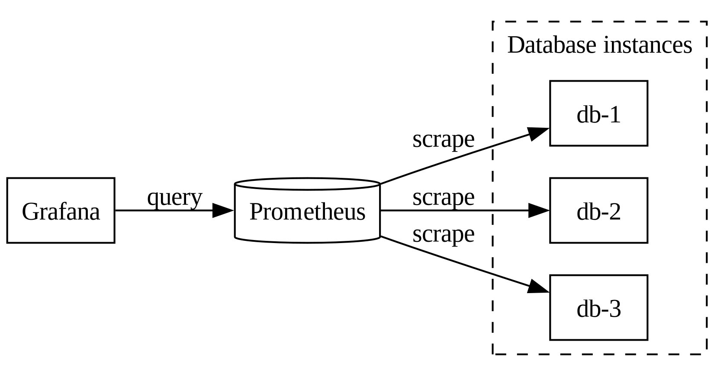
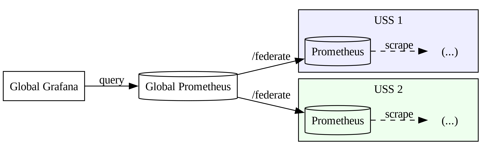

# Monitoring

## Prerequisites

Some of these [tools](../deployment/services/index.md#prerequisites) are required to interact with monitoring services.

## Grafana / Prometheus stack

When enabled, an instance of Grafana and Prometheus are deployed along with the
core DSS services; this combination allows you to view (Grafana) metrics
(collected by Prometheus).



This can be enabled via:

- The `enable_monitoring` option in terraform
- The `monitoring.enabled` option in helm
- The `enableMonitoring` option in tanka (enabled by default)

By default, DSS metrics are not enabled; see below, OpenTelemetry section, to activate them.

### Grafana access

To access the Grafana interface, first ensure that the appropriate
cluster context is selected (`kubectl config current-context`). Then, run the
following command:

```shell
kubectl get pod | grep grafana | awk '{print $1}' | xargs -I {} kubectl port-forward {} 3000
```

While that command is running, open a browser and navigate to
[http://localhost:3000](http://localhost:3000).

The default username is `admin` with a default password of `admin` if using tanka, or a random value in a kubernetes secret named `<release>-grafana` if using helm charts.

Example to retrieve the secret in a default 'dss' release:

```shell
kubectl get secrets/dss-grafana -o jsonpath="{.data.admin-password}" | base64 -d
```

Click the magnifying glass on the left side to select a dashboard to view.

### Prometheus access

Prometheus access is protected by a client certificate. If you need to access the web interface, you will need to import a valid client certificate in your browser.

!!! info
    For day to day usage, you don't need to access Prometheus, use Grafana instead. This is only useful for debugging.

To build a pkcs12 file from a valid client certificate (use a random password):

=== "Yugabyte"
    ```
    openssl pkcs12 -export -inkey deploy/operations/certificates-management/workspace/demo/clients/client.grafana.key -in deploy/operations/certificates-management/workspace/demo/clients/client.grafana.crt  -out /tmp/cert_key.p12
    ```

=== "CockroachDB"
    ```
    openssl pkcs12 -export -inkey build/workspace/demo/client_certs_dir/client.grafana.key -in build/workspace/demo/client_certs_dir/client.grafana.crt -out /tmp/cert_key.p12
    ```

---

Then import this file as client certificate in your browser.

* Firefox: Preferences > Privacy & Security > View Certificates > Your Certificates > Import
* Chrome: Privacy and security > Security > Manage Certificates > Import

Next time you access the interface, select the certificate you just imported.

## Prometheus Federation (Multi Cluster Monitoring)

[Prometheus Federation](https://prometheus.io/docs/prometheus/latest/federation/)
enables you to easily monitor multiple clusters of the DSS that you operate,
unifying all the metrics into a single Prometheus instance where you can build
Grafana Dashboards. Enabling Prometheus Federation is optional.




To enable it, you need to do two things:

1. Externally expose the Prometheus service of the DSS clusters.
2. Deploy a "Global Prometheus" instance to unify metrics.

### Externally Exposing Prometheus

=== "Terraform managed"

    1. Set the option `prometheus_hostname` to the value of the public hostname that will be used to access your instance.
    2. Apply changes as usual, first by running terraform, and then tanka or helm

=== "Helm managed"

    1. Set `monitoring.externalService.enabled` to `true`
    2. [Optional] Set `monitoring.externalService.ip` set to a static external IP
    3. [Optional] Set `monitoring.externalService.subnet` if you use AWS.

=== "Tanka managed"

    1. Set `expose_external` to `true`
    2. [Optional] Supply a static external IP Address to `IP`

### Deploy "Global Prometheus" instance

1. Follow guide to deploy Prometheus https://prometheus.io/docs/introduction/first_steps/
2. The scrape rules for this global instance will scrape other prometheus `/federate` endpoints and are rather simple, please look at the [example configuration](https://prometheus.io/docs/prometheus/latest/federation/#configuring-federation) as a starting point.
3. You will need to enable a client certificate, as this is used to protect the endpoint.
    * This uses the same CAs in a cluster. You can use any generated certificate with all Prometheus instances in a cluster.
    * Copy the private (`client.grafana.key`), public (`client.grafana.crt`), and CA (`ca.crt`) keys and make them available to your Prometheus instance, next to the config. Folders are:

    === "Yugabyte"
        `deploy/operations/certificates-management/workspace/demo/clients/`

    === "CockroachDB"
        `build/workspace/demo/client_certs_dir/`

<ol start="4"><li>Add encryption to your config:

```
tls_config:
    ca_file:   ca.pem
    cert_file: client.grafana.crt
    key_file:  client.grafana.key

```

</li></ol>

## OpenTelemetry

[OpenTelemetry](https://opentelemetry.io/) is an open-source observability framework for cloud-native software.

You can enable it on the DSS server to get:

* Tracing for all queries
* A Prometheus endpoint with some metrics

Currently, thoses settings are not yet available in Terraform, Helm or Tanka.

!!! warning

    By default, when metrics are enabled, the metrics service listens on all addresses.


### Metrics

Use flag `--enable_metrics` to enable metrics.

Point any Prometheus server to the endpoint (by default on port 8079).

You can use the `--metrics_addr` flag to change the listening port and address.

A dashboard is automatically deployed by Helm and Tanka. If you use you own grafana instance, it can be found [there](https://github.com/interuss/dss/blob/master/deploy/services/tanka/grafana_dashboards/dss.json).

You can use the `enable_dss_metrics` option in Terraform, `dss.conf.enableDssMetrics` in Helm, or `enableDssMetrics` in Tanka to activate it when using these.
This will also automatically enable collection by Prometheus if used.

### Tracing

Use flag `--enable_tracing` to enable tracing.

Traces can be sent to any OpenTelemetry-compliant service. Self-hostable examples include [Jaeger](https://www.jaegertracing.io/), [OpenObserve](https://github.com/openobserve/openobserve), [Grafana Tempo](https://grafana.com/docs/tempo/latest/), and [SigNoz](https://github.com/SigNoz/signoz). Multiple SaaS solutions are also available (including some of the previously mentioned tools).

You need to use the `OTEL_EXPORTER_OTLP_ENDPOINT` environment variable to configure it. Point it toward your server by following its specific documentation.

[Other variables for telemetry](https://opentelemetry.io/docs/languages/sdk-configuration/otlp-exporter/) (and [variables in general](https://opentelemetry.io/docs/languages/sdk-configuration/general/)) supported by the Go language are available as well if needed.

For local debugging, enable the `with-monitoring` profile in the standalone
Docker Compose deployment:

```bash
COMPOSE_PROFILES=with-monitoring ./build/dev/run_locally.sh
```

This enables DSS metrics and tracing and starts Prometheus, Grafana, and Jaeger.
Grafana is available at http://localhost:3000 with the DSS dashboard already
configured (use `admin` for both the username and password), Prometheus is
available at http://localhost:9090, and Jaeger is available at
http://localhost:16686.

See the [standalone local instance documentation](https://github.com/interuss/dss/blob/master/build/dev/standalone_instance.md#monitoring)
for more details.

## Raft store metrics

When the DSS instance runs the
[Raft store](../deployment/pooling/raft.md), the core-service exposes
additional `raft_*` metrics on the same metrics endpoint, describing the state
of the three Raft groups (`aux`, `rid`, `scd`) of the node.  They are enabled
like the other DSS metrics: `enable_dss_metrics` in Terraform,
`dss.conf.enableDssMetrics` in Helm, `enableDssMetrics` in Tanka, or the
`--enable_metrics` flag; when using the deployment tools, collection by
Prometheus is enabled with them.

A **Raft** dashboard is automatically deployed by Helm and Tanka, alongside
the other DSS dashboards. If you use your own Grafana instance, it can be found
[there](https://github.com/interuss/dss/blob/master/deploy/services/tanka/grafana_dashboards/raft.json).
It gives, per Raft group:

* the current state of the group: state, leader, term, and the history of the
  leadership changes,
* the replication progress: commit index vs applied index, the apply lag, the
  lag of each follower,
* the health of the links to the peers: latency (current, average, min, max,
  standard deviation) and the AppendEntries success/failure counts, reported
  by the leader,
* the storage: WAL write and fsync durations, bytes written, the snapshot
  durations and frequency, the number of log entries,
* the load: the proposal duration, the pending proposals (writes and reads)
  and the proposal rate.

The complete list of the metrics is in the
[raftstore source](https://github.com/interuss/dss/tree/master/pkg/raftstore).
The metrics below are the ones worth alerting on:

| Metric | Description | Alert criteria |
| :--- | :--- | :--- |
| `raft_peer_tls_handshake_failures_total{reason}` | Connections from Raft peers rejected during the TLS handshake, per node. | Sustained growth: a participant's CA is not (or no longer) trusted by the pool, see [Troubleshooting](./troubleshooting.md#raft-store) for the reasons. |
| `raft_trusted_ca_not_after_seconds{subject, serial}` | Expiry (seconds since the Unix epoch) of each CA of the trusted bundle, per node. | A CA is close to its expiry: rotate it before it expires (see [certificates](../deployment/pooling/raft.md#certificates)). |
| `raft_is_leader{group, node_id}` / `raft_state{group, node_id, state}` | Leadership and state of each group, per node. | A group with no leader on any node, or frequent state transitions (elections). |
| `raft_follower_lag_entries{group, node_id, peer_id}` | Number of committed entries a follower has not applied yet, reported by the leader. | A follower that is not catching up. |
| `raft_proposals_pending{group, node_id, type}` | Number of pending write (or read) proposals of the node. | A persistent backlog: the node is not keeping up with the traffic of the pool. |
| `raft_proposal_duration_seconds{group, node_id, type}` | Duration of the proposals of the node. | Sustained increase of the write latency of the pool. |
| `raft_peer_send_fail_total{group, node_id, peer_id}` | Cumulative number of failed messages sent to a peer, reported by the leader. | Growth: the link to the peer is broken or saturated. |

`raft_peer_tls_handshake_failures_total` counts every rejection, with one of
the following `reason` values (each rejected connection is also logged as a
warning by the node, at most one line per reason every 5 seconds):

| Reason | Meaning |
| :--- | :--- |
| `not_tls` | The peer does not use TLS |
| `closed` | The peer closed the connection during the handshake |
| `remote_rejected` | The peer does not trust the certificate of this node |
| `unknown_authority` | The peer certificate is not signed by a CA of the bundle |
| `invalid_date` | The peer certificate has expired or is not valid yet |
| `bad_certificate` | Any other invalid peer certificate |
| `other` | Any other failure |
